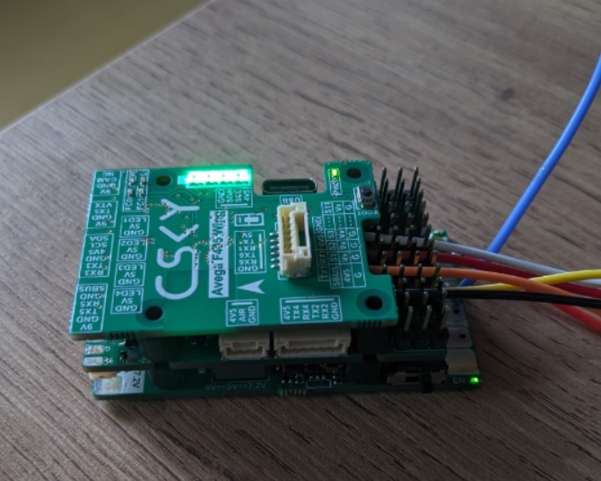
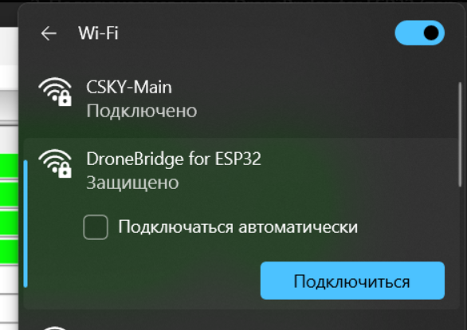
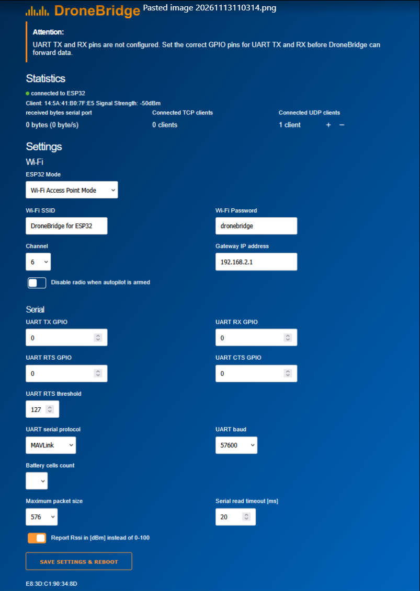
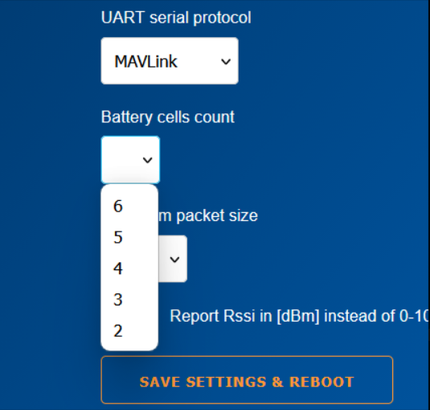

## Подготовка и подключение к Wi‑Fi

1. **Подайте питание на плату распределения питания (PDB) от аккумулятора (2S–6S LiPo).**

   Включите питание полётного контроллера и дождитесь завершения самотестирования.

{width=670px height=537px scale=570px}

2. **Подключитесь к Wi‑Fi сети модуля WCB.**

   На компьютере откройте список сетей и подключитесь к точке доступа:
   - SSID: *DroneBridge for ESP32* (или аналогичное название).
   - Пароль по умолчанию: *dronebridge*.

{width=586px height=414px scale=574px}

## **Настройка батареи через веб‑интерфейс**

Если требуется вручную задать количество ячеек батареи:

3. Откройте в браузере адрес *dronebridge.local*.

{width=803px height=1132px scale=447px}

4. В разделе **Battery Cells** выберите нужное количество ячеек (от 2S до 6S).

{width=535px height=510px scale=445px}

5. По умолчанию стоит 0 -- в этом режиме плата попытается автоматически определить количество ячеек по напряжению. Это может привести к ошибке, поэтому для надёжности лучше выставить значение вручную.
6. Нажмите **SAVE SETTINGS & REBOOT**. Контроллер применит настройки и перезагрузится.

## **Подключение к Mission Planner**

7. Запустите **Mission Planner** на компьютере.
8. В правом верхнем углу в выпадающем списке выбора порта выберите тип подключения:
   - **UDP**: выберите UDP и укажите порт *14550*.
   - **TCP**: выберите TCP, введите IP‑адрес *192\.168.2.1* и порт *5760*. Оба варианта поддерживаются DroneBridge.
9. Нажмите кнопку **CONNECT**. Mission Planner должен установить соединение и начать загрузку параметров с полётного контроллера.

**Важно для UDP:** при использовании UDP наземная станция (Mission Planner или любая другая GCS) должна отправить хотя бы один пакет (например, MAVLink heartbeat) на UDP‑порт устройства, чтобы зарегистрироваться как конечная точка. Обычно это происходит автоматически.
