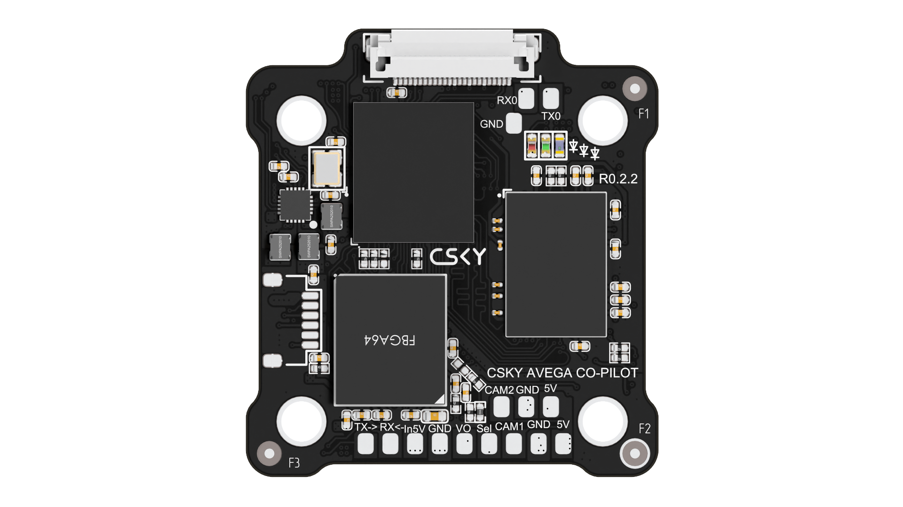

{width=1920px height=1080px scale=780px}

{width=1920px height=1080px}

Модуль Avega CO-Pilot I на базе процессора Allwinner H618 -- компактный вычислительный узел. Может применяться как самостоятельный процессорный модуль либо как вычислительный сопроцессор в составе системы управления БПЛА.

## **Назначение и ключевые решения**

Основное назначение -- обработка видеопотока и выполнение вычислительно интенсивных задач в реальном времени.

**Ключевые решения:**

- **Расчёт скорости и перемещения** методами Optical flow и Visual odometry -- подходит для оценки движения носителя и компенсации вибраций.
- **Детектирование и отслежевание объектов в кадре** -- реализуемо на OpenCV, YOLO и аналогичных фреймворках под Linux.
- **Точная посадка по видеоданным** -- за счёт анализа маркеров/рельефа и выдачи управляющих команд через UART/USB/Ethernet.
- **Мультисенсорная интеграция** -- одновременная обработка данных с двух аналоговых камер и телеметрии полётного контроллера.

## **Технические характеристики**

| **Характеристика** | **Значение** | **Примечания** |
|---|---|---|
| Процессор | Allwinner H618 | SoC с интегрированной периферией |
| Количество и тип ядер | 4 ядра Cortex‑A53 | 64‑битная архитектура, кэш L1/L2 |
| Тактовая частота | до 1,5 ГГц | Динамическое масштабирование частоты в зависимости от нагрузки и температуры |
| ОЗУ | LPDDR4/LPDDR4X, 4 ГБ | Подходит для буферизации видео и ML‑задач среднего масштаба |
| Встроенная память (eMMC) | 8 ГБ | Достаточно для ОС, базовых библиотек и логов; для моделей и датасетов рекомендуется SD‑карта |
| Поддержка загрузки образа | с SD‑карты | Удобно для отладки и смены сборок без перепрошивки eMMC |
| Напряжение питания | 4,8–5,2 В | Рекомендуемый диапазон для стабильной работы; чувствителен к просадкам при пиковых нагрузках |
| Входы для аналоговых камер | 2 шт. | Возможность одновременного захвата двух потоков для стерео‑ или мультисенсорных задач |
| Интерфейсы UART | 2 шт. | Поддержка MAVLink, MSP и кастомных протоколов; возможна аппаратная развязка и гальваническая изоляция на стороне платы расширения |
| Интерфейсы USB | 2 шт. | USB 2.0 -- подходит для периферии, камер, накопителей, отладки |
| Интерфейс Ethernet | 1 шт. | 10/100/1000 Мбит/с; полезен для удалённой отладки, передачи видео и телеметрии |
| Поддерживаемые ОС | Armbian, Ubuntu | Полноценный Linux с поддержкой драйверов и кросс‑компиляции |
| Форм‑фактор и крепление | 30,5 × 30,5 мм | Стандартные монтажные отверстия; совместимость с типовыми креплениями в корпусах БПЛА |
| Масса |  | Масса указана без учёта крепежных элементов/кабелей |
| Рабочая температура | От -40 до +50 °C | Диапазон рабочих температур указан без учёта нагрева от солнечной радиации и собственного тепловыделения при максимальной нагрузке |

## **Интеграция с полётным контроллером**

Для связи с полётным контроллером предусмотрены следующие варианты:

- **UART (2 шт.) с протоколами MAVLink и MSP.** Оптимально для передачи телеметрии и команд управления с минимальной задержкой. При проектировании рекомендуется предусмотреть гальваническую развязку и защиту линий от помех.
- **USB.** Подходит для отладки, передачи логов и временных сценариев.
- **Ethernet.** Удобен для удалённого доступа, передачи видеопотока и интеграции в бортовую сеть; при использовании через модуль расширения -- учитывать задержки и топологию сети.

## **Особенности разработки и эксплуатации**

- **Модуль поставляется без прошивки.** Это позволяет использовать собственные образы ОС и ПО либо применять публикуемые примеры для гражданских задач.
- **Открытые интерфейсы взаимодействия.** Возможна разработка на Python (для быстрого прототипирования и скриптов) и C++ (для высокопроизводительных модулей обработки видео и управления).
- **Рекомендации по питанию.** При одновременной работе двух камер и активных вычислениях возможны кратковременные пики потребления -- рекомендуется стабилизированный источник питания с запасом по току и фильтрацией помех.
- **Тепловой режим.** При длительных вычислениях (ML‑инференс, декодирование видео) желательно предусмотреть пассивное охлаждение (радиатор) либо учитывать деградацию производительности при перегреве.

## **Практические советы для инженерной проработки**

- **Для видеозахвата** с аналоговых камер -- оценить совместимость драйверов в выбранной сборке Armbian/Ubuntu и заложить тестовые сценарии с разными разрешениями и кадровыми частотами.
- **При реализации optical flow/visual odometry** -- учесть влияние вибраций и смаза изображения; полезно добавить программную стабилизацию и фильтрацию выбросов.
- **Для интеграции MAVLink** -- использовать готовые библиотеки (например, pymavlink для Python или libmavlink для C++) и предусмотреть обработку ошибок связи и таймаутов.
- **При разработке под C++** -- оптимизировать обработку кадров, использовать аппаратные возможности (если доступны) и избегать лишних копирований данных между буферами.

## **Преимущества для закупочной спецификации**

- **Компактность и простота монтажа.** Форм‑фактор 30,5 × 30,5 мм с типовым креплением позволяет легко интегрировать модуль в корпуса и платы существующих изделий.
- **Гибкость загрузки и развёртывания.** Поддерживается загрузка образа с SD‑карты -- это упрощает тестирование и смену прошивок на этапе опытной эксплуатации.

## **Публикуемые примеры для работы**

### **Подключение платы к плате прошивки**
