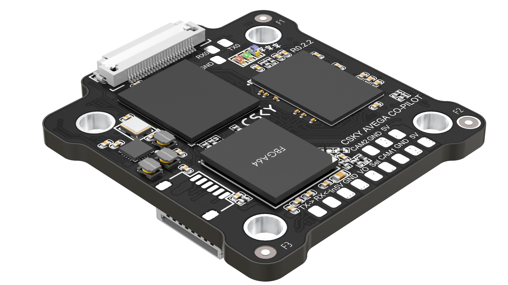

{width=1920px height=1080px}

Модуль Avega CO-Pilot I на базе процессора Allwinner H618 -- компактный вычислительный узел. Может применяться как самостоятельный процессорный модуль либо как вычислительный сопроцессор в составе системы управления БПЛА.

## **Назначение и ключевые решения**

Основное назначение -- обработка видеопотока и выполнение вычислительно интенсивных задач в реальном времени.

**Ключевые решения:**

- **Расчёт скорости и перемещения** методами Optical flow и Visual odometry -- подходит для навигации по визуальным данным.
- **Детектирование и отслеживания объектов в кадре** -- реализуемо на OpenCV, YOLO и аналогичных фреймворках под Linux.
- **Точная посадка по видеоданным** -- за счёт анализа маркеров/рельефа и выдачи управляющих команд через UART/USB/Ethernet.

  ## **Технические характеристики**



---

*  **Характеристика**

*  **Значение**

---

*  

   Процессор

*  Allwinner H618

---

*  4 ядра Cortex‑A53

---

*  до 1,5 ГГц

---

*  ОЗУ

*  LPDDR4/LPDDR4X, 4 ГБ

---

*  Встроенная память (eMMC)

*  8 ГБ

---

*  Поддержка загрузки образа

*  с SD‑карты

---

*  Напряжение питания

*  4,8–5,2 В

---

*  Входы для аналоговых камер

*  2 шт.

---

*  Интерфейсы UART

*  2 шт.

---

*  Интерфейсы USB

*  2 шт.

---

*  Интерфейс Ethernet

*  1 шт.

---

*  Поддерживаемые ОС

*  Armbian, Ubuntu

---

*  Форм‑фактор и крепление

*  30,5 × 30,5 мм

---

*  Масса

*  11,5 гр.

---

*  Рабочая температура

*  От -40 до +50 °C



## **Интеграция с полётным контроллером**

Для связи с полётным контроллером предусмотрены следующие варианты:

- **UART (2 шт).** Оптимально для передачи телеметрии и команд управления с минимальной задержкой. При проектировании рекомендуется предусмотреть гальваническую развязку и защиту линий от помех.
- **USB.** Подходит для отладки, передачи логов и временных сценариев.
- **Ethernet.** Удобен для удалённого доступа, передачи видеопотока и интеграции в бортовую сеть; при использовании через модуль расширения -- учитывать задержки и топологию сети. Используется для доступа по SSH.

## **Особенности разработки и эксплуатации**

- **Открытые интерфейсы взаимодействия.** Возможна разработка на Python (для быстрого прототипирования и скриптов) и C++ (для высокопроизводительных модулей обработки видео и управления).
- **Рекомендации по питанию.** При одновременной работе двух камер и активных вычислениях возможны кратковременные пики потребления -- рекомендуется стабилизированный источник питания с запасом по току и фильтрацией помех.
- **Тепловой режим.** При длительных вычислениях (ML, декодирование видео) необходимо использовать радиатор.

## **Преимущества для закупочной спецификации**

- **Компактность и простота монтажа.** Форм‑фактор 30,5 × 30,5 мм с типовым креплением позволяет легко интегрировать модуль в корпуса и платы существующих изделий.
- **Гибкость загрузки и развёртывания.** Поддерживается загрузка образа с SD‑карты -- это упрощает тестирование и смену прошивок на этапе опытной эксплуатации.

## Дополнительная информация

- [Схема подключения платы](./skhema-podklyucheniya-platy.md)
- [Установка образа системы](./ustanovka-obraza-sistemy-v-emmc.md)
- [Примеры программ](./primery-raboty-s-platoy-avega-co-pilot-i.md)
