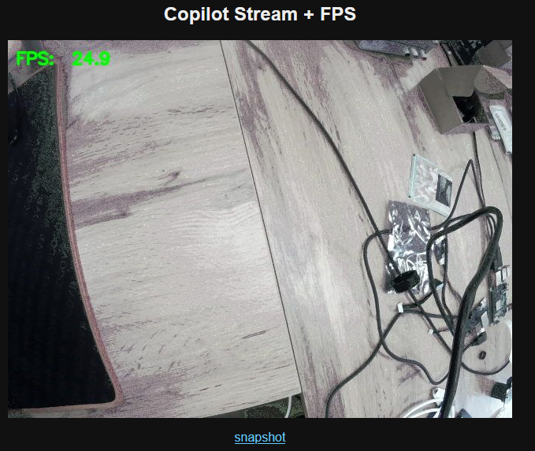
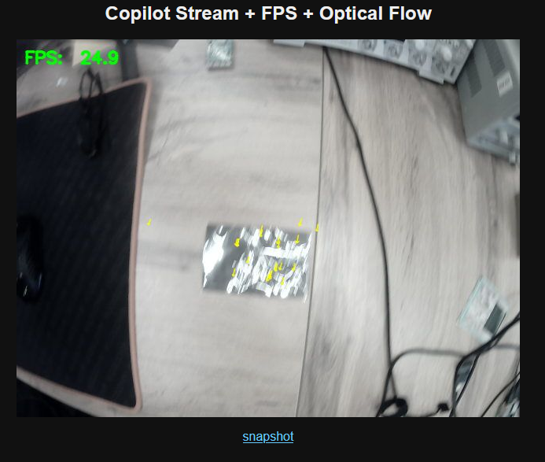
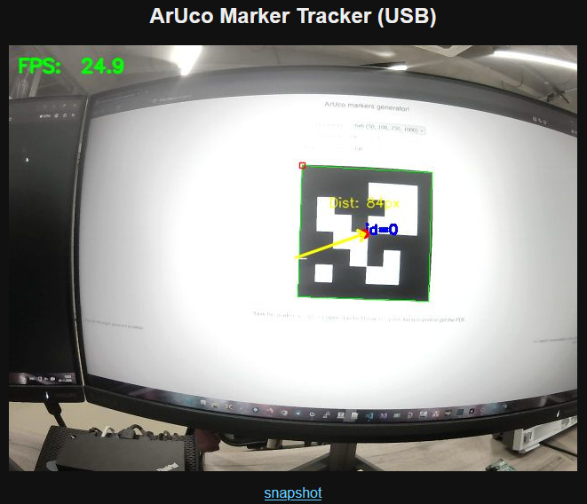

## **Подключение к плате.**

По умолчанию плата запускается в режиме со статическим IP-адресом (192.168.1.100). Для подключения к плате требуется настроить DNS для работы со статическими IP.

## Для Windows

1. Нажмите клавиши **Win + I**, чтобы открыть «Параметры Windows»
2. Перейдите в раздел **Сеть и Интернет**
3. Выберите тип подключения **Ethernet**
4. Нажмите кнопку **Редактировать** рядом с пунктом «Назначение IP»
5. В выпадающем списке выберите **Вручную** и активируйте переключатель **IPv4**
6. Заполните поля:\
   \- **IP-адрес**: 192.168.1.10\
   \- **Маска подсети**: 255.255.255.0\
   \- **Шлюз**: 192.168.1.1\
   \- **DNS-серверы**: 8.8.8.8
7. Нажмите **Сохранить**.

## **Для Linux**

1. Узнайте имя вашего сетевого интерфейса (например, `eth0` или `enp3s0`): Для этого введите команду `ip a`
2. Откройте конфигурационный файл (его имя может немного отличаться): `sudo nano /etc/netplan/01-netcfg.yaml`
3. ```
   network:
    version: 2
    renderer: networkd
     ethernets:
       enp3s0: # Замените на имя вашего интерфейса
         dhcp4: no
         addresses:
           - 192.168.1.10
         routes:
           - to: default
             via: 192.168.1.1
         nameservers:
           addresses: # DNS-серверы
   ```
4. Сохраните файл (`Ctrl+O`, затем `Enter`) и выйдите (`Ctrl+X`).
5. Примените настройки:\
   `sudo netplan apply`

## Включение платы

1. Подключите плату к полетному контроллеру, аккумулятору и плате расширения как показано на схеме подключения
2. Подключите разъем Ethernet платы расширения к аналогичному разъему Вашего ПК или маршрутизатору
3. Подключите аккумулятор и дождитесь загрузки системы
4. Откройте терминал на вашем ПК (в Windows это PowerShell или CMD).
5. Выполните команду: `ssh 192.168.1.100`. При первом запуске появится предупреждение о подлинности хоста (fingerprint). Введите Yes и нажмите Enter.
6. Введите имя пользователя: `root` и пароль:`RootPassword`

## **Запуск примеров**

Скачайте примеры работы платы по [ссылке](https://ftp.csky.space/firmware/copilot/copilot%20examples.zip). Распакуйте в удобную директорию в Copilot (например \~/examples/). Для запуска примеров используйте команды:

```
python3 ~/examples/copilot_stream.py
python3 ~/examples/copilot_flow.py
python3 ~/examples/copilot_mark.py
```

После запуска примера запустится трансляция изображения по адресу \<IP-адрес платы copilot>:8000

### **Пример** `copilot_stream.py`: трансляция видеопотока

В данном примере реализован стриминг видео. После запуска скрипт открывает локальный HTTP-сервер, по адресу `http://192.168.1.100:8000` становится доступна веб-страница с трансляцией в реальном времени, а по адресу `http://192.168.1.100:8000/stream.mjpg` -- сам MJPEG-поток. Дополнительно по пути `/snapshot.jpg` можно получить последний кадр в виде отдельного JPEG-файла. На рисунке приведен экран браузера при работе примера

{width=679px height=573px}

### Пример `copilot_flow.py`: трансляция видео с наложением оптического потока

В данном примере реализован стриминг видео с вычислением и визуализацией **оптического потока** (optical flow). После запуска скрипт открывает локальный HTTP-сервер, по адресу `http://192.168.1.100:8000` становится доступна веб-страница с трансляцией в реальном времени, а по адресу `http://192.168.1.100:8000/stream.mjpg` -- сам MJPEG-поток. Дополнительно по пути `/snapshot.jpg` можно получить последний кадр в виде отдельного JPEG-файла.

На каждом кадре поверх изображения отображаются:

- **счётчик FPS** в левом верхнем углу;
- **жёлтые стрелки**, показывающие направление и величину смещения характерных точек между последовательными кадрами.

  На рисунке приведен экран браузера при работе примера

{width=693px height=587px}

### Пример `copilot_mark.py`: трансляция видео с детекцией ArUco-маркера

В данном примере реализован стриминг видео с детекцией **ArUco-маркера** -- специального квадратного маркера с уникальным идентификатором, который используется для точной навигации дронов при посадке. После запуска скрипт открывает локальный HTTP-сервер, по адресу `http://192.168.1.100:8000` становится доступна веб-страница с трансляцией в реальном времени, а по адресу `http://192.168.1.100:8000/stream.mjpg` -- сам MJPEG-поток. Дополнительно по пути `/snapshot.jpg` можно получить последний кадр в виде отдельного JPEG-файла.

Пример маркера для детекции приведен в примерах под именем ArUco Mark.svg, для генерации своих маркеров можно использовать сайт <https://chev.me/arucogen/>, с размером 6×6 и «Marker ID» 1.

На каждом кадре поверх изображения отображаются:

- **счётчик FPS** в левом верхнем углу;
- **перекрестие** в центре кадра (идеальная точка для посадки);
- **зелёная рамка** вокруг найденного ArUco-маркера );
- **красная точка** в центре маркера;
- **жёлтая стрелка** от центра кадра к центру маркера -- вектор ошибки;
- **текст** `Dist: XXpx` над маркером с расстоянием в пикселях.

  На рисунке приведен экран браузера при работе примера

{width=661px height=568px}
